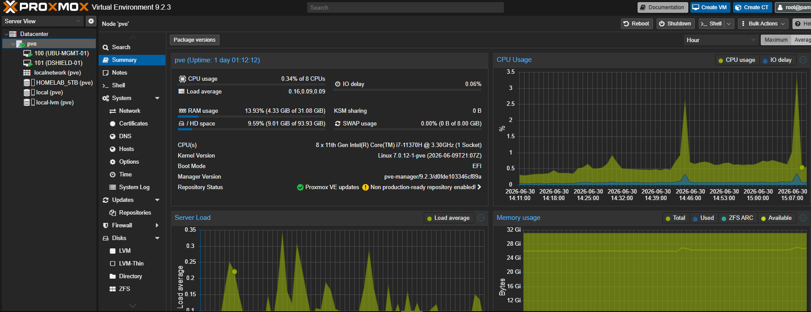
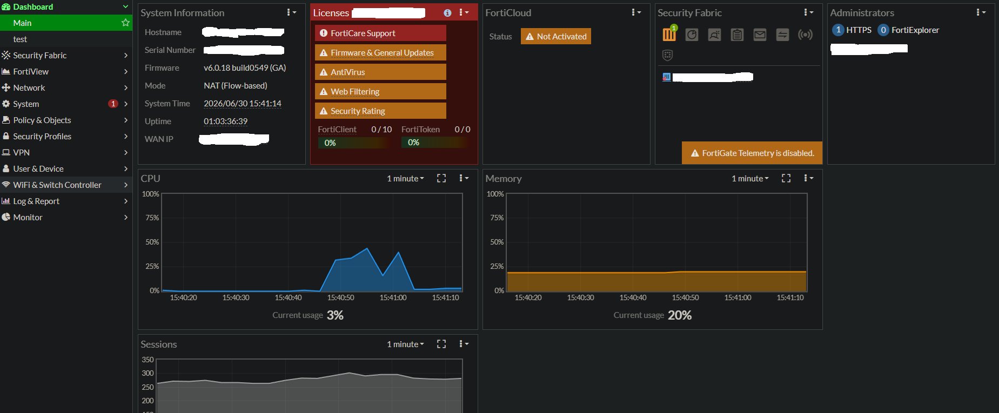
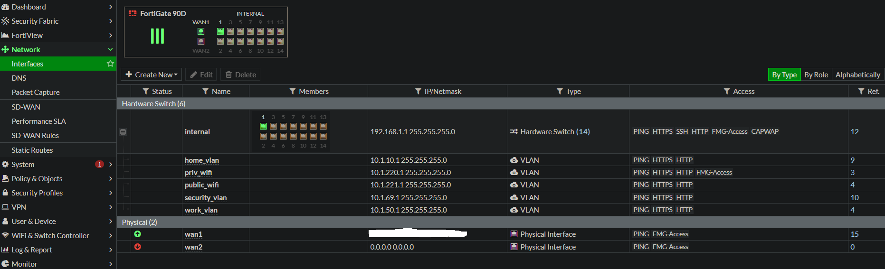

# CyberSecurity HomeLab

An enterprise-style cybersecurity home lab designed to simulate real-world infrastructure and security operations.

The environment includes enterprise firewalling, network segmentation, virtualization, Linux administration, secure Internet service exposure, and comprehensive infrastructure documentation.

---

# Project Overview

This HomeLab was built to gain practical experience with enterprise networking, cybersecurity, virtualization, and systems administration.

Rather than focusing on individual technologies, the project emphasizes designing, deploying, documenting, securing, and maintaining a complete enterprise-style infrastructure.

Current implementation includes:

- Enterprise firewall deployment
- Internal infrastructure management network
- Network segmentation
- Proxmox virtualization
- Ubuntu Server administration
- Internet-facing DShield Honeypot
- Managed Layer 2 switching
- VM snapshots and backups
- Infrastructure documentation
- Git-based configuration management

---

# Proxmox Virtualization Platform   👈 INSERT THIS NEW SECTION HERE

The CyberSecurity-HomeLab is hosted on a dedicated Proxmox VE virtualization platform running enterprise-style virtual infrastructure for management and security operations.



---

# FortiGate Edge Firewall

The CyberSecurity-HomeLab uses a FortiGate 90D as the primary edge firewall. It provides WAN connectivity, inter-VLAN routing, stateful firewall inspection, NAT, Virtual IP (VIP) publishing for Internet-facing services, and policy enforcement across segmented networks.



---

# Network Segmentation

The FortiGate firewall provides inter-VLAN routing and policy enforcement for multiple isolated network segments. The environment separates management, trusted home devices, work systems, wireless networks, guest access, and security infrastructure to reduce attack surface and improve security.



---

# Current Architecture

> **Detailed architecture diagrams are available in the `/diagrams` directory.**

```
                    Internet
                        │
                        ▼
                  Fiber ONT
                        │
                        ▼
                 FortiGate 90D
                        │
                        ▼
         Ubiquiti Switch Lite 8 PoE
                        │
        ┌───────────────┼────────────────┐
        │               │                │
        ▼               ▼                ▼
 Internal /        Segmented         Wireless
 Management         Networks         Networks
  Network
                        │
        ┌───────────────┼───────────────────────────────┐
        │               │               │               │
        ▼               ▼               ▼               ▼
   Home Network    Work Network   Security Network  Private Wi-Fi
                                         │
                                         ▼
                                DShield Honeypot

                        ▼
              Proxmox Virtualization Host
                        │
        ┌───────────────┴───────────────┐
        │                               │
        ▼                               ▼
   Ubuntu Server                 DShield Honeypot
```

---

# Technology Stack

## Networking

- FortiGate 90D
- Ubiquiti Switch Lite 8 PoE
- IEEE 802.1Q VLANs
- VLAN Trunking
- NAT
- Virtual IPs (VIPs)

## Virtualization

- Proxmox VE
- Virtual Machines
- Snapshots
- VM Backups

## Operating Systems

- Ubuntu Server LTS

## Security

- DShield Honeypot
- Network Segmentation
- Least Privilege
- Stateful Firewall Inspection
- Firewall Policy Enforcement

## Administration

- SSH
- Git
- GitHub

---

# Documentation

Detailed technical documentation is available in the **/docs** directory.

| Document | Description |
|----------|-------------|
| Project Overview | Overall project goals and objectives |
| Hardware Inventory | Physical infrastructure and hardware specifications |
| Network Architecture | High-level network design |
| VLAN Design | Segmentation strategy and VLAN implementation |
| IP Addressing Plan | Network addressing and subnet design |
| Proxmox Configuration | Virtualization platform deployment |
| FortiGate Configuration | Firewall implementation and security policies |
| Ubiquiti Switch Configuration | Managed switch configuration |
| Ubuntu Server | Linux server deployment and administration |
| DShield Honeypot | Internet-facing threat monitoring |
| Backup & Recovery | Backup strategy and disaster recovery planning |

---

# Skills Demonstrated

This project demonstrates practical experience with:

- Enterprise Network Design
- VLAN Segmentation
- Firewall Administration
- Linux Administration
- Virtualization
- Secure Remote Administration
- Network Security
- Threat Monitoring
- Infrastructure Documentation
- Backup & Recovery
- Change Management
- Troubleshooting
- Git Version Control

---

# Current Project Status

✔ Production network deployed

✔ Fiber ONT connected directly to FortiGate WAN

✔ Internal infrastructure management network operational

✔ Network segmentation validated

✔ Home, Work, Security, Private Wi-Fi, and Guest Wi-Fi networks operational

✔ Internet-facing DShield Honeypot deployed

✔ Live attack traffic observed and validated

✔ VM snapshots and backup strategy implemented

Project progress is tracked in:

- `PROJECT_STATUS.md`
- `ROADMAP.md`

---

# Future Enhancements

Planned future work includes:

- Microsoft Sentinel SIEM
- Centralized Log Collection
- Threat Hunting Workflows
- MITRE ATT&CK Mapping
- Active Directory Lab
- Windows Server Infrastructure
- Detection Engineering
- Python Automation
- PowerShell Automation
- Infrastructure Monitoring

---

# Disclaimer

This repository is intended for educational and professional portfolio purposes.

Sensitive information including credentials, public IP addresses, firewall secrets, VPN configuration, and other security-sensitive information has been removed or sanitized before publication.
