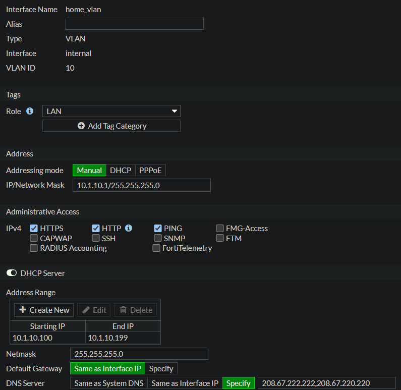
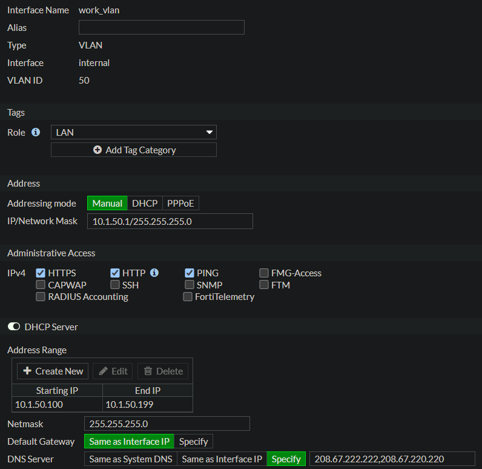
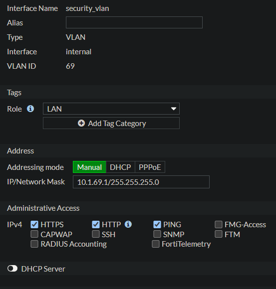
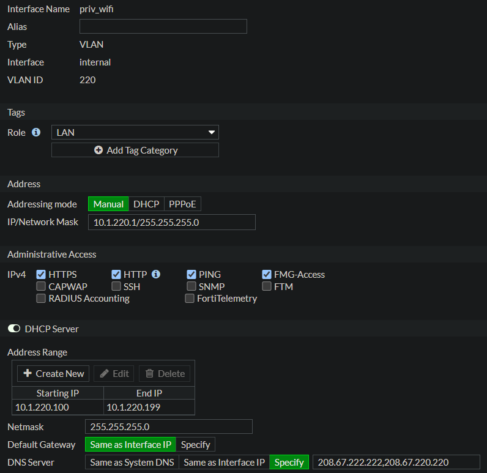
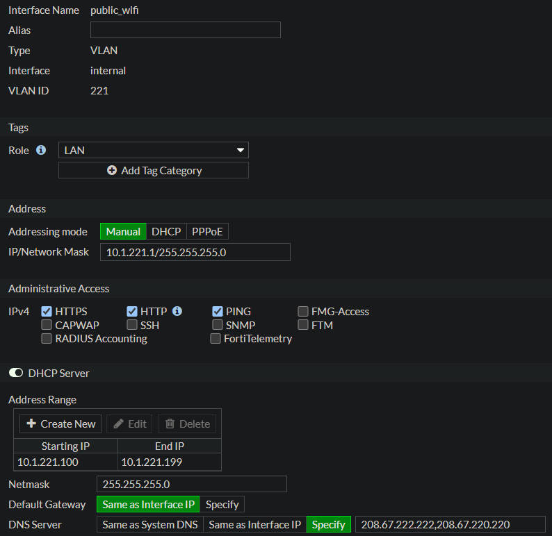

# VLAN Design

## Overview

The HomeLAB uses IEEE 802.1Q VLAN segmentation to separate network traffic into distinct security zones. Each VLAN serves a specific purpose and is routed through the FortiGate firewall to enforce security policies and reduce the risk of lateral movement.

| VLAN | Purpose | Network |
|------|---------|---------|
| 10 | Home | 10.1.10.0/24 |
| 50 | Work | 10.1.50.0/24 |
| 69 | Security | 10.1.69.0/24 |
| 220 | Private WiFi | 10.1.220.0/24 |
| 221 | Public WiFi | 10.1.221.0/24 |
| Management | Infrastructure | 192.168.1.0/24 |

## Design Goals

- Isolate work devices from personal devices.
- Separate security tooling from trusted networks.
- Provide isolated guest wireless access.
- Centralize routing through the FortiGate firewall.
- Minimize lateral movement between network segments.

## Routing

All inter-VLAN routing is performed by the FortiGate 90D using Layer 3 VLAN interfaces.

## DHCP

Each VLAN has a dedicated DHCP scope configured on the FortiGate firewall. This provides centralized IP address management while maintaining logical separation between network segments.

---

## FortiGate VLAN Configuration

### Home VLAN

### Work VLAN

### Security VLAN

### Private WiFi VLAN

### Public WiFi VLAN

